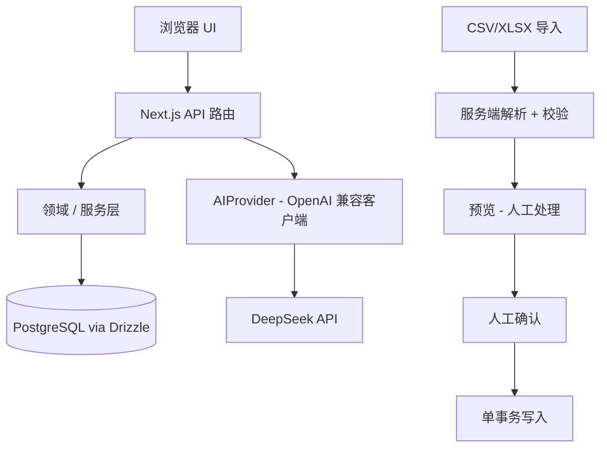
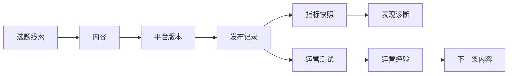

# ContentLoop

**让每次表现，成为下一次创作的依据。**

一个面向 3–5 人内容团队的 AI 内容运营工作台，覆盖 小红书 / Bilibili / 抖音 的内容生产、发布、复盘与经验沉淀。

> 规格文档：[PRD](docs/ContentLoop_PRD_v1.md) · [数据模型](docs/ContentLoop_data-model_v1.md) · [设计](docs/ContentLoop_design_v1.md) · [演示脚本](docs/demo-script.md)。Agent 工作契约：`AGENTS.md`。里程碑记录：`docs/progress/`。

---

## 为什么是 ContentLoop

内容运营的信息散落在选题想法、文档、平台草稿、发布记录、数据表格、复盘笔记和团队记忆里。结果是：团队不断生产内容，却很少把真实表现沉淀为下一次可复用的运营知识。大多数 AI 工具止步于"生成"。ContentLoop 关注的是闭环的另一半——度量、诊断、验证与经验回流。

## 核心闭环

```text
选题线索 → 内容 → 发布 → 数据 → 表现诊断 → 运营测试 → 运营经验 → 下一条内容
```

一个真实跑通的闭环，胜过一堆互不连通的 AI 功能。

## 它做什么

- **首页** —— 此刻什么需要你处理，接下来该做什么。
- **选题雷达** —— 把零散的线索变成有依据的选题决定。
- **内容工作台** —— 把一个定下来的选题做成结构化、可审核的内容资产（内容简报 → 内容母稿 → 平台版本）。
- **内容流程** —— 跟踪每条内容处于哪个阶段，并记录真实的发布事实。
- **数据复盘** —— 用真实指标和自身历史基线回答"这条内容表现怎么样"。
- **设置** —— 指标定义与平台规范（工具页）。

## 产品原则

- **业务先于 AI** —— AI 服务于运营判断，而不是取代它。
- **证据先于观点** —— 先看事实和基线，再谈解释。
- **AI 提供建议，最终由你确认** —— 没有人的确认，AI 的产出不会生效。
- **没有数据不等于零** —— 未录入不是 0。
- **演示数据清晰隔离** —— 演示内容有明确标识，绝不混入真实基线。
- **经验是可复用的参考，不是自动改写** —— 应用一条经验不会改动你的内容。

## 演示路径

一条 5–8 分钟的闭环演示见 [`docs/demo-script.md`](docs/demo-script.md)，另有 2–3 分钟的面试简版。它沿一条选题线索走完：创建、审核、发布、录入真实数据、诊断、运营测试、沉淀经验，再回到下一条内容。

## AI 帮什么，又不决定什么

| AI 场景 | AI 做的 | 人必须做的 |
|---|---|---|
| 线索分析 | 带证据分层给出评估建议 | 选用或跳过这条线索 |
| 简报草稿 | 起草八个简报字段 | 审核、应用或放弃，然后确认 |
| 平台适配 | 把母稿改写为平台草稿（修改前/后对照） | 接受或拒绝 |
| 表现诊断 | 基于真实指标提出解读 | 编辑并保存（或放弃） |
| 经验草稿 | 从已完成的测试起草措辞 | 编辑并保存 |

ContentLoop 不是自治代理。AI 不能确认简报、不能发布、不能下测试结论、不能保存运营经验。没有配置 AI key 时，所有手动流程照常可用。

## 数据信任

- **发布记录 ≠ 内容** —— 发布记录是"真的发出去了"的事实（标题、时间、链接）。
- **24h / 72h 数据** —— 发布后约 24 / 72 小时人工读取的指标点。
- **留空 ≠ N/A ≠ 0** —— 留空是还没录入，N/A 是本次没有该项数据，0 是真实测到的 0。
- **账号 / 方向中位数** —— 本工作区最近 20 条可比发布的中位数。绝不是行业基准。
- **演示隔离** —— `isDemo` 内容可见、可用于指标/诊断/测试，但不进入运营基线候选。纯演示库里，基线正确地显示 N/A。
- **诊断证据** —— 保存时定格；数据变化会明确提示，绝不静默复用。
- **测试证据** —— 结论时定格，判断始终可回溯。
- **经验溯源** —— 每条运营经验都能回到它的来源测试。

> 演示指标是用于产品体验的合成示例，不是真实投放成绩，也不进入运营基线。

## 运营测试与运营经验

**ContentLoop 不做统计显著性检验。** 运营测试是人对已发布内容证据的对比判断：测试 → 观察到的证据 → 人下结论（支持假设 / 不支持假设 / 有得有失 / 无明确结论）→ 可选地沉淀为运营经验。经验由你选择应用到未来的内容——不是自动改写。

## 架构



简化领域模型：



完整 20 张表的数据模型见 [`docs/ContentLoop_data-model_v1.md`](docs/ContentLoop_data-model_v1.md)。

## 技术栈

- **Next.js 16 + React 19 + TypeScript** —— 一个类型安全的全栈代码库。
- **Tailwind CSS 4** —— token 驱动的 editorial 设计系统。
- **Drizzle ORM + postgres.js + Supabase PostgreSQL** —— 类型化 schema、可提交的迁移链。
- **DeepSeek（OpenAI 兼容客户端）** —— 只是协议客户端，不是模型路由器；AI 结构化输出在写入前一律经 **Zod** 校验。
- **SheetJS** —— 服务端 CSV/XLSX 解析，用于指标导入。
- **framer-motion + vendored React Bits（ShinyText）** —— 克制的品牌化动效；reduced-motion 安全。
- **Vitest + jsdom** —— 390+ 单元与组件级测试。

## 演示数据

`pnpm db:seed:demo` 会载入演示线索、演示内容和带 24h/72h 数据的已发布 DEMO fixtures，足够体验完整闭环。所有演示内容都有明确标识，不声称是真实业绩。

## V1 边界

V1 明确**不做**：应用级 Auth/RBAC、多品牌/多工作区、平台 API 同步、自动发布、爬虫、日历、全局 Ask Loop、统计显著性、自动经验/自动应用、i18n、移动端优先。这些是范围决策，不是缺失的功能。

## 安全与发布边界

**ContentLoop V1 没有应用级认证与授权。** 所有写接口在设计上无鉴权（单团队私有工具）。

- 不要在未验证外部访问控制的前提下，把可写的 ContentLoop 实例暴露到公网。
- 人工确认是工作流边界（AI 提议、人确认），**不是**身份认证。
- 发布模式：本地/私有可写 ✅；受保护的在线 demo 🟡（须先验证托管层保护）；公开可写 ❌ V1 禁止。

---

# Technical Runbook

## Requirements

- Node.js 20+ and pnpm
- A PostgreSQL database (Supabase recommended; any Postgres 14+ works)
- Optional: DeepSeek API key (AI features degrade to manual workflow without it)

## Install

```bash
pnpm install
```

## Environment

```bash
cp .env.example .env
# fill in DATABASE_URL (required) and AI_API_KEY (optional)
```

All variables are server-only. See `.env.example` for the exact list —
there are no `NEXT_PUBLIC_*` variables and no other secrets.

## Database Setup

ContentLoop uses Supabase as managed PostgreSQL only (no Supabase Auth,
Realtime, or Storage). Create a project, copy the connection URI into
`DATABASE_URL`. The Supabase pooler URI works for both runtime and
migrations.

## Migrations

```bash
pnpm db:migrate    # apply committed migrations (db/migrations 0000–0011)
```

`db:generate` / `db:push` are development tools for schema work; releases
use committed migrations only.

## Bootstrap Seed

```bash
pnpm db:seed       # required bootstrap: Brand, Team Members, Pillars,
                   # Playbooks, Metric Definitions
```

Idempotent — re-running changes nothing (a workspace with an existing
Brand is considered bootstrapped).

## Optional Demo Seed

```bash
pnpm db:seed:demo  # optional: demo Signals/Contents + published DEMO
                   # fixtures with 24h/72h metrics
```

Also idempotent. All demo Content rows carry `isDemo=true` (the only demo
authority); demo metrics are preset exploration values, never real
performance, and are excluded from operational baseline cohorts.

## Development

```bash
pnpm dev           # Next.js dev server
pnpm test          # vitest
pnpm lint
pnpm typecheck
```

## Production Build

```bash
pnpm build
```

## Production Start

```bash
pnpm start         # serves the production build
```

## AI Configuration

DeepSeek official API (OpenAI-compatible), server-only key. Requests time
out at 60s; AI routes declare `maxDuration = 60`. Without a valid key the
UI shows a sanitized message and every manual workflow remains fully
available. AI never writes authoritative state without human confirmation.

## Deployment

Primary: **Vercel** — set `DATABASE_URL` (+ optional `AI_*`) in project
env, deploy the Next.js app as-is. Hobby plans support `maxDuration` up
to 60s — if your plan caps lower, long AI requests may be cut off at the
platform edge; use the fallback instead.

Fallback: **Docker/VPS + `pnpm build && pnpm start`** behind your own
access-control layer — no platform time limit, you manage protection.

Whichever target: the database is Supabase PostgreSQL over the pooler URI.

### Access protection

V1 has no application login. For an online demo, put the deployment behind
hosting-level access control (e.g. Vercel Password Protection / your
reverse proxy's auth). Verify the protection is actually enabled on your
plan before exposing a writable workspace.

## Demo Database Reset

To reset a **demo** database (never your production workspace):

1. Drop and recreate the database (or use your provider's backup/export
   first if anything matters).
2. `pnpm db:migrate && pnpm db:seed && pnpm db:seed:demo`

There is no in-app reset feature.

## Known limitations

- No application-level Auth/RBAC (see Security).
- Current visuals are not the final pass (unified visual polish pending).
- Real-workflow dogfood of a live publication is still pending; a full
  functional loop was validated with an isolated external-proxy test.
