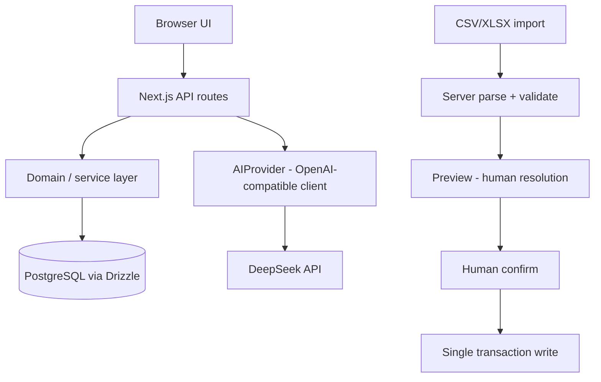
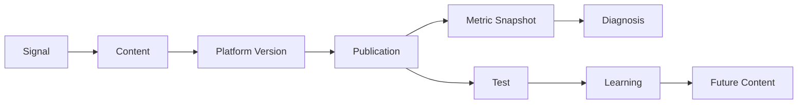

# ContentLoop

**ContentLoop closes the loop between content creation and content performance — it turns what happened into what you do next.**

An AI-assisted content operations workspace for 3–5 person teams, covering 小红书 / Bilibili / 抖音 workflows.

> Specifications: [PRD](docs/ContentLoop_PRD_v1.md) · [data model](docs/ContentLoop_data-model_v1.md) · [design](docs/ContentLoop_design_v1.md) · [demo script](docs/demo-script.md). Agent operating contract: `AGENTS.md`. Milestone history: `docs/progress/`.

---

## Why ContentLoop

Content operations information fragments across idea lists, docs, platform drafts, publication records, metric spreadsheets, postmortems and team memory. The result: teams keep producing content, but performance rarely becomes reusable operating knowledge. Most AI tools stop at *generation*. ContentLoop is built around the rest of the loop — measurement, diagnosis, validation, and reusable learning.

## The Core Loop

```text
Signal → Content → Publish → Metrics → Diagnosis → Test → Learning → Next Content
```

One real closed loop is worth more than many disconnected AI features.

## What it does

- **Home** — what needs your attention right now, and where to continue.
- **Radar** — turn raw leads into deliberate content decisions.
- **Studio** — turn a selected idea into a structured, reviewable content asset (Brief → Content Master → platform versions).
- **Pipeline** — track each content's stage and record real publication facts.
- **Analytics** — answer "how did this post do" with real metrics against your own history.
- **Settings** — metric definitions and platform playbooks (utility surface).

## Product principles

- **Business before AI** — AI serves the operation, not the other way around.
- **Evidence before opinion** — facts and baselines first, interpretation second.
- **AI proposes, Human confirms** — nothing AI produces takes effect without a human.
- **Missing data is not zero** — unrecorded is not zero.
- **Demo data is clearly separated** — demo content is marked and never pollutes your real baselines.
- **Learning is reusable context, not automatic rewriting** — applying a learning never rewrites your content.

## Demo journey

A 5–8 minute closed-loop walkthrough lives in [`docs/demo-script.md`](docs/demo-script.md), including a 2–3 minute interview version. It follows one Signal through creation, review, publication, real metrics, diagnosis, a Test, a Learning, and into the next Content.

## Where AI helps — and where it never decides

| AI surface | AI does | Human must |
|---|---|---|
| Radar Analyze | suggest an evaluation with evidence tiers | select / skip the signal |
| Brief Draft | draft the eight brief fields | review, Apply or Discard, then Approve |
| Platform Adapt | rewrite the master into a platform draft (OLD/NEW diff) | Accept or Reject |
| Diagnosis | propose an interpretation of real metrics | edit and Save (or discard) |
| Learning Draft | draft wording from a concluded test | edit and Save |

ContentLoop is not autonomous. AI cannot approve a brief, publish, conclude a test, or save a learning. Without an AI key, every manual workflow remains fully available.

## Data trust

- **Publication ≠ Content** — a publication is the recorded fact that something really went live (title, time, URL).
- **24h / 72h snapshots** — human-read metric checkpoints after publishing.
- **Blank ≠ N/A ≠ 0** — blank is unresolved, N/A means unavailable for that snapshot, 0 is a real measured zero.
- **Account / Pillar median** — the median of your own last 20 comparable posts. Never an industry benchmark.
- **Demo exclusion** — `isDemo` content is visible for exploration and usable for Metrics / Diagnosis / Tests, but excluded from operational baseline cohorts. On a demo-only database, baselines correctly show N/A.
- **Diagnosis evidence** — captured at save time; stale data is flagged, never silently reused.
- **Test evidence** — frozen at conclusion; the decision stays auditable.
- **Learning provenance** — every learning links back to its source test.

> Demo metrics are synthetic examples for product exploration. They are not real campaign results and are excluded from operational baseline cohorts.

## Tests and Learnings

**ContentLoop does not calculate statistical significance.** A Test is a human-defined operational comparison against published content evidence: Test → observed evidence → human conclusion (Win / Loss / Trade-off / No clear result) → optional Learning. A Learning is context you choose to apply to future content — not automatic rewriting.

## Architecture



Simplified domain model:



The full 20-table model: [`docs/ContentLoop_data-model_v1.md`](docs/ContentLoop_data-model_v1.md).

## Tech stack

- **Next.js 16 + React 19 + TypeScript** — one typed full-stack codebase.
- **Tailwind CSS 4** — token-driven editorial design system.
- **Drizzle ORM + postgres.js + Supabase PostgreSQL** — typed schema, committed migration chain.
- **DeepSeek via OpenAI-compatible client** — a protocol client, not a model router; structured outputs validated with **Zod** before any write.
- **SheetJS** — server-side CSV/XLSX parsing for metric import.
- **framer-motion + vendored React Bits (EchoText / BlurText / ShinyText)** — restrained brand moments; reduced-motion safe.
- **Vitest + jsdom** — 390+ unit and component-level tests.

## Demo data

`pnpm db:seed:demo` loads demo Signals, demo Contents, and published DEMO fixtures with 24h/72h metrics — enough to explore the full loop. All demo content is marked; none of it claims real performance.

## V1 scope boundaries

Deliberately **not** in V1: application Auth/RBAC, multi-brand/workspace, platform API sync, auto-publishing, crawler, calendar, a global "Ask Loop" agent, statistical significance, automatic Learning/Apply, i18n, mobile-first. These are scope decisions, not missing features.

## Security & release boundary

**ContentLoop V1 has no application-level authentication or authorization.** Every write API is unauthenticated by design (single-team private tool).

- Do not expose a writable ContentLoop workspace to the public internet without an external access-control layer, and verify that protection on your actual deployment first.
- Human confirmation is a workflow boundary (AI proposes, humans confirm), **not** identity authentication.
- Release modes: local/private writable ✅; protected online demo 🟡 only after verified hosting-level protection; public writable ❌ prohibited in V1.

---

# Technical Runbook

## Requirements

- Node.js 20+ and pnpm
- A PostgreSQL database (Supabase recommended; any Postgres 14+ works)
- Optional: DeepSeek API key (AI features degrade to manual workflow without it)

## Install

```bash
pnpm install
```

## Environment

```bash
cp .env.example .env
# fill in DATABASE_URL (required) and AI_API_KEY (optional)
```

All variables are server-only. See `.env.example` for the exact list —
there are no `NEXT_PUBLIC_*` variables and no other secrets.

## Database Setup

ContentLoop uses Supabase as managed PostgreSQL only (no Supabase Auth,
Realtime, or Storage). Create a project, copy the connection URI into
`DATABASE_URL`. The Supabase pooler URI works for both runtime and
migrations.

## Migrations

```bash
pnpm db:migrate    # apply committed migrations (db/migrations 0000–0011)
```

`db:generate` / `db:push` are development tools for schema work; releases
use committed migrations only.

## Bootstrap Seed

```bash
pnpm db:seed       # required bootstrap: Brand, Team Members, Pillars,
                   # Playbooks, Metric Definitions
```

Idempotent — re-running changes nothing (a workspace with an existing
Brand is considered bootstrapped).

## Optional Demo Seed

```bash
pnpm db:seed:demo  # optional: demo Signals/Contents + published DEMO
                   # fixtures with 24h/72h metrics
```

Also idempotent. All demo Content rows carry `isDemo=true` (the only demo
authority); demo metrics are preset exploration values, never real
performance, and are excluded from operational baseline cohorts.

## Development

```bash
pnpm dev           # Next.js dev server
pnpm test          # vitest
pnpm lint
pnpm typecheck
```

## Production Build

```bash
pnpm build
```

## Production Start

```bash
pnpm start         # serves the production build
```

## AI Configuration

DeepSeek official API (OpenAI-compatible), server-only key. Requests time
out at 60s; AI routes declare `maxDuration = 60`. Without a valid key the
UI shows a sanitized message and every manual workflow remains fully
available. AI never writes authoritative state without human confirmation.

## Deployment

Primary: **Vercel** — set `DATABASE_URL` (+ optional `AI_*`) in project
env, deploy the Next.js app as-is. Hobby plans support `maxDuration` up
to 60s — if your plan caps lower, long AI requests may be cut off at the
platform edge; use the fallback instead.

Fallback: **Docker/VPS + `pnpm build && pnpm start`** behind your own
access-control layer — no platform time limit, you manage protection.

Whichever target: the database is Supabase PostgreSQL over the pooler URI.

### Access protection

V1 has no application login. For an online demo, put the deployment behind
hosting-level access control (e.g. Vercel Password Protection / your
reverse proxy's auth). Verify the protection is actually enabled on your
plan before exposing a writable workspace.

## Demo Database Reset

To reset a **demo** database (never your production workspace):

1. Drop and recreate the database (or use your provider's backup/export
   first if anything matters).
2. `pnpm db:migrate && pnpm db:seed && pnpm db:seed:demo`

There is no in-app reset feature.

## Known limitations

- No application-level Auth/RBAC (see Security).
- Current visuals are not the final pass (unified visual polish pending).
- Real-workflow dogfood of a live publication is still pending; a full
  functional loop was validated with an isolated external-proxy test.
