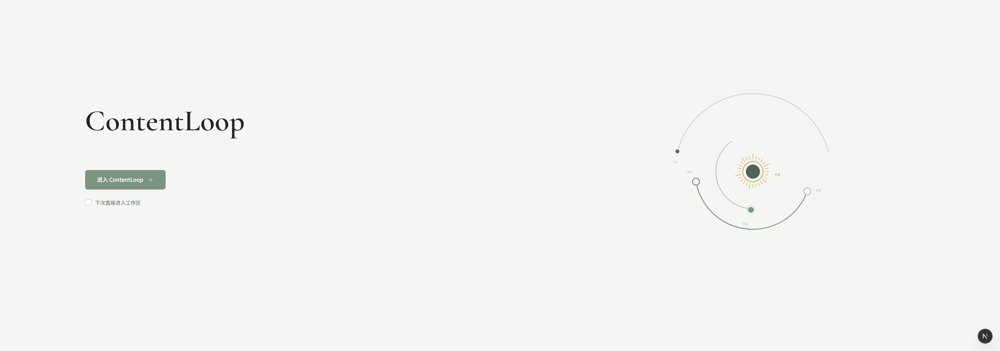
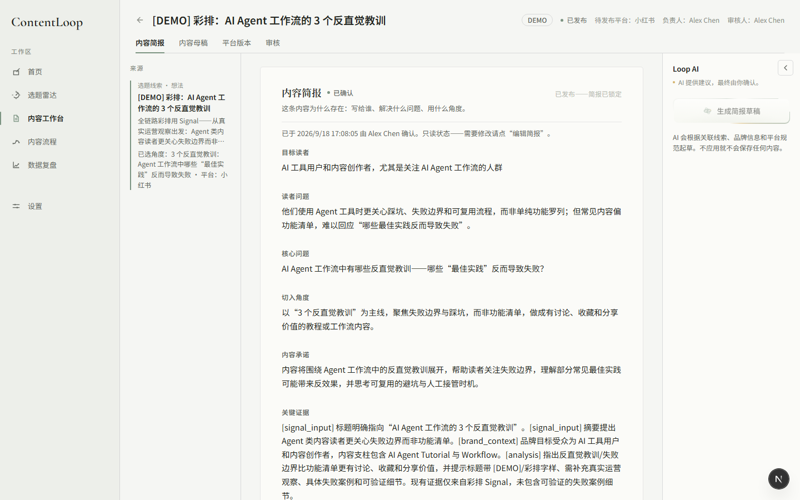
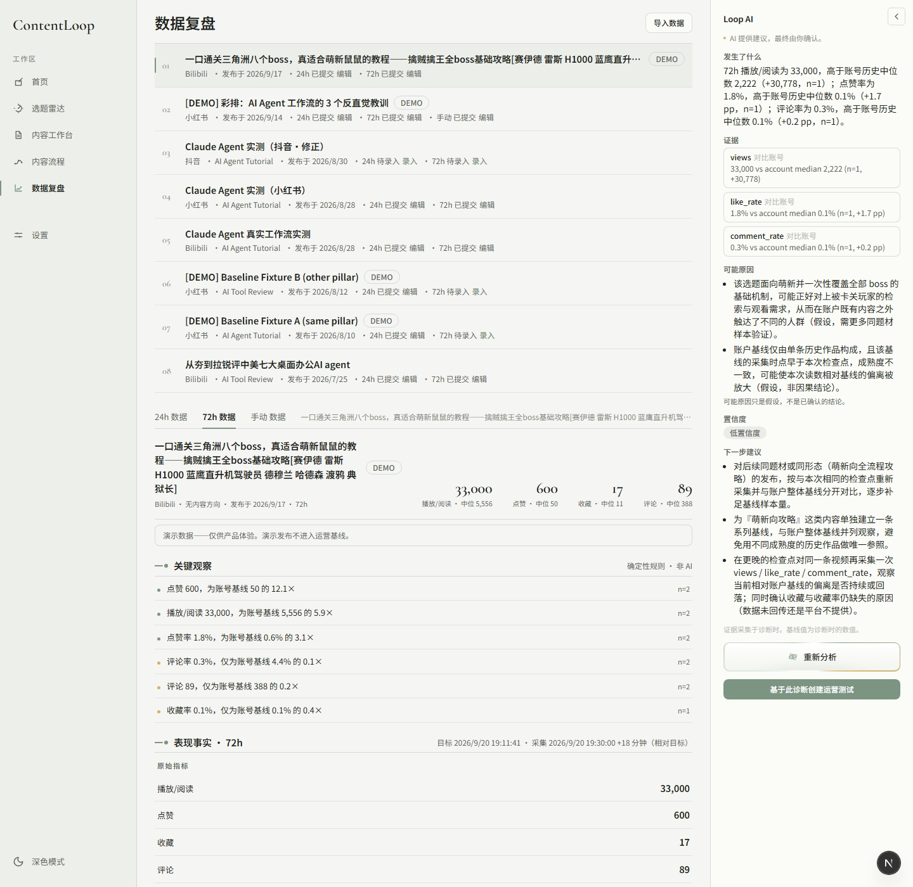
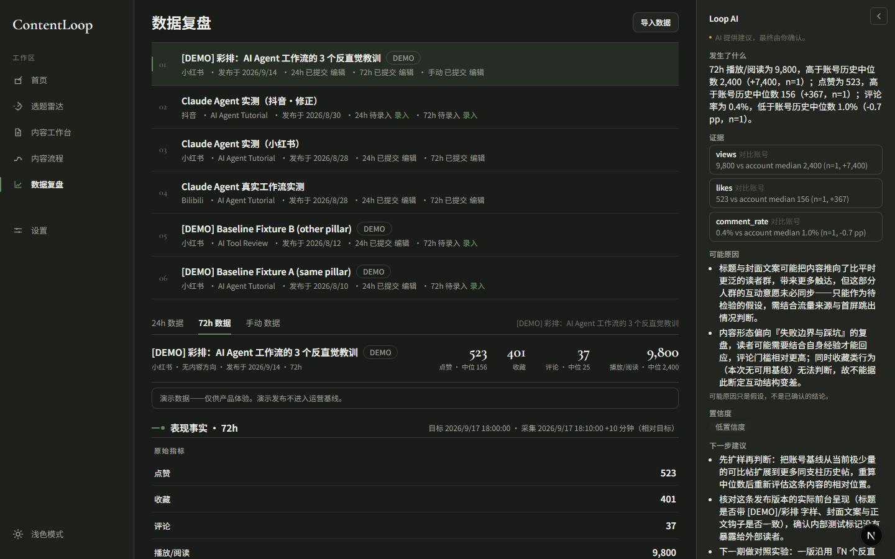

# ContentLoop

<p align="center">
  <strong>把内容团队的选题、发布和复盘数据，收进同一条可追踪的工作流。</strong>
</p>

<p align="center">
  面向 3–5 人内容团队的 AI 内容运营工作台。<br>
  从选题线索到 24h/72h 数据复盘，再到沉淀经验反哺下一条内容，支持小红书 / Bilibili / 抖音。
</p>

<p align="center">
  <a href="#在线体验">在线体验</a> ·
  <a href="#快速开始">快速开始</a> ·
  <a href="#使用指南">使用指南</a> ·
  <a href="#工作原理">工作原理</a> ·
  <a href="#开发与测试">开发与测试</a>
</p>



## 为什么选择 ContentLoop

内容运营的工作分散在选题文档、平台草稿、发布记录和数据表格里，发布之后的表现很少被认真沉淀。ContentLoop 把这条链路收进一个工作台：选题有评估依据，发布有真实记录，数据对照自己账号的历史基线，复盘结论可以沉淀为团队经验，并在下一条内容里被引用。

| 能力 | 说明 |
| --- | --- |
| 选题雷达 | 零散线索经 AI 分析给出评分与证据分层，人决定选用或跳过 |
| 结构化生产 | 内容简报 → 内容母稿 → 平台版本三步推进，AI 起草的改动以 OLD/NEW 对照呈现，逐条接受或拒绝 |
| 真实发布记录 | 发布必须登记平台、标题、时间与链接，只改状态不算发布 |
| 自身基线复盘 | 指标对照账号近 20 条中位数，关键观察自动标注偏离，不引用行业基准 |
| 经验回流 | 测试结论经人工确认后保存为运营经验，后续创作时自动推荐、一键应用 |
| 双主题 | 浅色纸面 / 深色仪器，颜色全部走设计令牌，动效双主题适配 |

## 在线体验

- 入口页：<https://contentloop-howard15.vercel.app/?gateway=1>
- 日常访问 <https://contentloop-howard15.vercel.app> 即可，入口页勾选「下次直接进入工作台」后会跳过入口页

部署在 Vercel + Supabase，实例无登录墙（V1 定位为单团队内部工具）。演示数据带 DEMO 标识，可随意操作，不计入运营基线。

## 产品预览

### 内容工作台

三栏布局：左侧素材来源，中间写作区（简报 / 母稿 / 平台版本 / 审核四个页签），右侧 Loop AI 面板。AI 生成内容较长时，点栏边箭头展开为宽幅审阅视图。



### 数据复盘

当前值与基线中位数并排展示，关键观察区标出明显偏离的指标，右栏可生成 AI 诊断。证据不足时诊断会明确返回 insufficient_evidence，不强行下结论。



### 深色模式



## 快速开始

```bash
pnpm install
cp .env.example .env   # 填 DATABASE_URL（必需）和 AI_API_KEY（可选）
pnpm db:migrate        # 应用迁移
pnpm db:seed           # 基础配置（品牌/成员/方向/规范/指标定义）
pnpm db:seed:demo      # 可选：演示数据，足够体验完整闭环
pnpm dev               # http://localhost:3000
```

没有 AI key 也能跑，所有 AI 入口自动降级为手动流程。

## 使用指南

ContentLoop 的用法是沿一条固定流水线推进工作，每步的产物是下一步的输入。中途不知道做什么时，看首页「待处理」。

**首次准备（约 5 分钟）**

1. 设置 → 团队成员：把协作者加进成员列表
2. 设置 → 品牌信息：确认品牌定位和内容方向与实际账号一致
3. 设置 → 指标定义：核对指标别名与派生公式（如「播赞比」），全站计算以此为准

**日常流程（七步）**

1. **选题雷达**：新建线索、粘贴原始材料，点「AI 分析」看评分与证据分层，由人决定选用或跳过
2. **内容简报**：逐项填写八个字段，可让 AI 先起草，改完点「确认简报」——确认后才进入正式生产
3. **母稿 → 平台版本**：先写与平台无关的母稿，再选平台让 AI 适配，OLD/NEW 对照逐条确认
4. **审核**：完成五项检查清单后点「审核通过」，内容进入看板「待发布」列
5. **发布**：内容发出后在看板卡片登记平台、最终标题、发布时间、链接四项
6. **录数据**：发布后约 24h / 72h，首页会提醒录入；没拿到的数据留空（留空 ≠ N/A ≠ 0），千位逗号可直接粘贴
7. **测试 → 经验**：基于诊断创建运营测试，人下结论，有价值的结论保存为经验，下次写简报时会被推荐并应用

**实际案例**

这条流水线用一条真实发布的 B 站视频完整跑通过（《从夯到拉锐评中美七大桌面办公AI agent》）：24h 数据 3,066 播放 / 446 收藏，72h 涨到 8,890 / 773，复盘显示收藏率显著高于自身基线——工具型内容的典型信号。据此建了运营测试验证假设，结论沉淀为一条经验，并在下一条同方向内容的简报里被推荐应用。完整记录见 `docs/progress/M9-summary.md`。

**常见问题**

| 问题 | 说明 |
| --- | --- |
| 带 DEMO 标记的内容 | 演示数据，随意操作，不影响真实基线 |
| 没有 AI key | 分析、简报、适配均可手动完成 |
| 数据填错 | 数据复盘页可补录修正，已保存的诊断会提示证据变化 |
| 指标口径不一致 | 在设置 → 指标定义里调整 |
| 新增平台 | V1 仅支持小红书 / B站 / 抖音，属范围决策 |

## 工作原理

```text
选题线索 → 内容 → 平台版本 → 发布 → 24h/72h 数据 → 诊断 → 运营测试 → 运营经验 → 下一条内容
```

| 阶段 | 模块 | 责任 |
| --- | --- | --- |
| 选题 | 选题雷达 | 线索录入、AI 评估、人工决策 |
| 生产 | 内容工作台 | 简报、母稿、平台版本、审核 |
| 发布 | 内容流程 | 五列看板、真实发布登记 |
| 复盘 | 数据复盘 | 指标录入、基线对照、关键观察、AI 诊断 |
| 沉淀 | 测试与经验 | 对比验证、结论确认、经验引用 |

## 设计原则

- **AI 起草，人确认**：确认简报、发布、下测试结论、保存经验、修改平台规范，这些操作只能由人完成；AI 结构化输出写入前一律经 Zod 校验
- **留空 ≠ N/A ≠ 0**：留空是没录入，N/A 是本次没有，0 是真实测到的 0
- **基线只用自己账号**：近 20 条可比内容的中位数，不引用行业基准
- **证据定格**：诊断与测试结论保存时定格，底层数据变化会明确提示，不静默复用
- **演示数据隔离**：DEMO 内容可见可体验，不进入基线
- **运营测试是人工对比判断**：不做统计显著性检验

## 技术栈

- **Next.js 16 + React 19 + TypeScript**：全栈单仓库
- **Tailwind CSS 4**：令牌驱动的 editorial 设计系统，双主题
- **Drizzle ORM + Supabase PostgreSQL**：20 张表，迁移链可提交
- **DeepSeek（OpenAI 兼容协议）**：单 provider 客户端
- **Vitest + jsdom**：430+ 单元与组件测试

## 开发与测试

```bash
pnpm dev / build / start / test / lint / typecheck
pnpm db:migrate      # 仅使用已提交的迁移（db/migrations）
pnpm db:seed         # 幂等基础配置
pnpm db:seed:demo    # 可选演示数据（isDemo=true，不进基线）
```

环境变量仅服务端使用：`DATABASE_URL`（必需）、`AI_API_KEY`（可选）、`AI_BASE_URL` / `AI_MODEL`（可选覆盖）。无 `NEXT_PUBLIC_*` 变量。

## 部署

Vercel 直接部署，AI 路由声明 `maxDuration = 60`。数据库连接必须使用 Supabase **Session Pooler** 地址——直连 `db.*.supabase.co` 是 IPv6-only，Vercel serverless 无法访问。自托管备选：任意 Docker/VPS 上 `pnpm build && pnpm start`。

安全边界：V1 按设计没有应用层登录（单团队内部工具），公开部署时请放在带访问控制的托管环境之后。

## 文档

规格文档：[PRD](docs/ContentLoop_PRD_v1.md) · [数据模型](docs/ContentLoop_data-model_v1.md) · [设计](docs/ContentLoop_design_v1.md) · [演示脚本](docs/demo-script.md)。里程碑记录：`docs/progress/M0–M9`。

## 参与贡献

欢迎提交问题报告与改进建议。改动数据模型或指标口径时，请同步更新对应测试与 `docs/` 下的规格文档。
