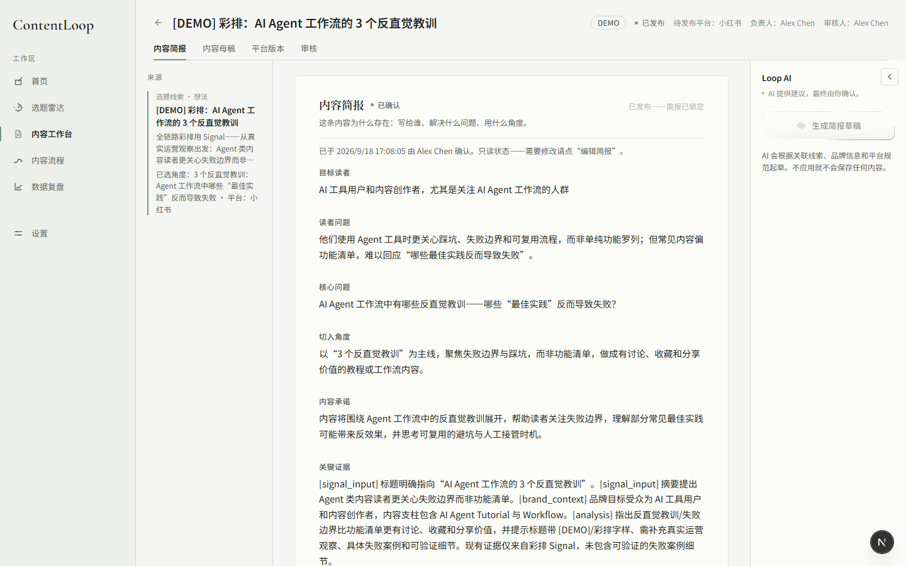
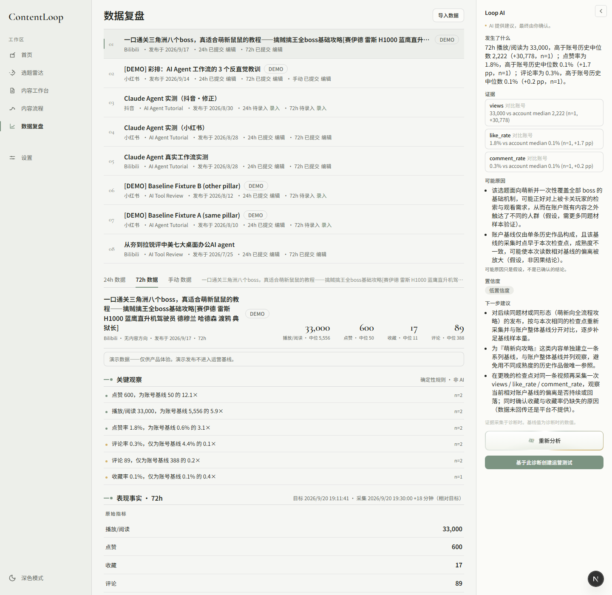
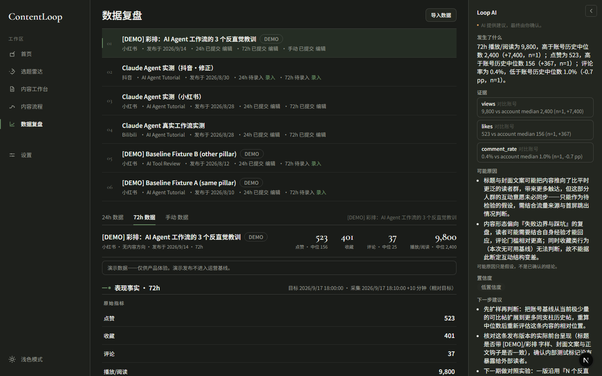

# ContentLoop

面向 3–5 人内容团队的 AI 内容运营工作台。覆盖选题、生产、发布、数据复盘与经验沉淀全流程，支持小红书 / Bilibili / 抖音。

<p>
  <a href="#在线体验">在线体验</a> ·
  <a href="#快速开始">快速开始</a> ·
  <a href="#使用指南">使用指南</a> ·
  <a href="#核心闭环">核心闭环</a> ·
  <a href="#功能模块">功能模块</a> ·
  <a href="#ai-能力边界">AI 边界</a> ·
  <a href="#技术栈">技术栈</a>
</p>


## 在线体验

- 入口页：<https://contentloop-howard15.vercel.app/?gateway=1>
- 进入后点击「进入工作台」到达首页；日常访问 <https://contentloop-howard15.vercel.app> 即可

部署于 Vercel + Supabase。实例无登录墙（V1 定位为单团队内部工具），演示数据带 DEMO 标识，与真实数据隔离、不计入运营基线。

> 说明：入口页提供「下次直接进入工作台」选项，勾选后 `/` 将跳过入口页。为协作者分享链接时建议使用上方带 `?gateway=1` 的地址，保证从入口页开始浏览。

## 产品定位

内容运营的日常工作分散在选题文档、平台草稿、发布记录和数据表格中，发布后的真实表现很少被结构化沉淀并反哺下一次创作。ContentLoop 将这条链路整合到一个工作台内：选题有据可依，发布有真实记录，数据对照自身历史基线，复盘结论可沉淀为团队经验并在后续创作中引用。

多数 AI 内容工具的能力止步于文本生成。ContentLoop 在此基础上补齐闭环的另一半：度量、诊断、验证与经验回流。

## 核心闭环

```text
选题线索 → 内容 → 平台版本 → 发布 → 24h/72h 数据 → 诊断 → 运营测试 → 运营经验 → 下一条内容
```

该闭环已使用一条真实发布的 B 站视频完整走通：从 AI 选题分析开始，到沉淀出一条可被后续内容引用的运营经验为止（详见 `docs/progress/M9-summary.md` 的真实数据走环记录）。

## 功能模块

| 模块 | 说明 |
| --- | --- |
| 首页 | 聚合当前待处理事项：待录入数据、待审核内容、进行中的测试 |
| 选题雷达 | 将零散线索转化为有依据的选题决策（AI 分析，人工决定选用或跳过） |
| 内容工作台 | 结构化生产流程：内容简报 → 内容母稿 → 平台版本（AI 起草，OLD/NEW 对照，人工确认） |
| 内容流程 | 五列看板跟踪内容阶段；发布需登记真实发布记录（平台/标题/时间/链接） |
| 数据复盘 | 真实指标对照自身历史基线（近 20 条中位数），附关键观察与 AI 诊断 |
| 设置 | 指标定义引擎（别名/派生公式）与三平台内容规范 |





## AI 能力边界

| 场景 | AI 职责 | 人工职责 |
| --- | --- | --- |
| 线索分析 | 按证据分层给出评估 | 决定选用或跳过 |
| 简报草稿 | 起草八个简报字段 | 审核、修改、确认 |
| 平台适配 | 将母稿改写为平台草稿 | 逐条接受或拒绝 |
| 表现诊断 | 基于真实指标提出解读 | 编辑后保存或放弃 |
| 经验草稿 | 从已完成测试起草措辞 | 编辑后保存 |

AI 不可执行的操作：确认简报、发布、下测试结论、保存经验、修改平台规范。未配置 AI key 时全部手动流程照常可用。AI 结构化输出写入前一律经 Zod 校验。

## 数据规范

- **留空 / N/A / 0 严格区分**：留空表示尚未录入，N/A 表示本次无该项数据，0 表示真实测得的 0
- **基线仅取自身账号近 20 条的中位数**，不引用行业基准
- **演示数据隔离**：DEMO 内容可正常浏览操作，不进入运营基线
- **证据定格**：诊断与测试结论保存时定格，底层数据变化会明确提示，不静默复用
- **运营测试为人工对比判断**，不做统计显著性检验

## 深色模式与设计

双主题（浅色纸面 / 深色仪器），全部颜色走设计令牌；动效组件（AI 思考、加载、入口页光环）均完成双主题适配。侧栏宠物「小环」随待办数量变化状态。



## 快速开始

```bash
pnpm install
cp .env.example .env   # 填 DATABASE_URL（必需）和 AI_API_KEY（可选）
pnpm db:migrate        # 应用迁移
pnpm db:seed           # 基础配置（品牌/成员/方向/规范/指标定义）
pnpm db:seed:demo      # 可选：演示数据，足够体验完整闭环
pnpm dev               # http://localhost:3000
```

未配置 AI key 也可运行，所有 AI 入口自动降级为手动流程。

## 使用指南

本节面向首次使用的协作者，按实际操作顺序说明各模块的使用方式。ContentLoop 的核心用法是沿一条固定流水线推进工作，每一步的产物是下一步的输入；中途不确定下一步时，查看首页「待处理」即可。

### 首次使用：5 分钟准备

1. **设置 → 团队成员**：将协作者加入成员列表（seed 含示例成员，可改可删）
2. **设置 → 品牌信息**：确认品牌定位与内容方向（Content Pillar）与实际运营的账号一致
3. **设置 → 指标定义**：核对指标别名与派生公式（如「播赞比」）是否符合团队口径——全站指标计算以此处为准
4. 右上角月亮图标切换深色模式；侧栏底部的宠物「小环」随待办数量变化状态

### 标准流程：七步

> 原则：每一步由人做决定，AI 负责起草与建议。

**第 1 步 · 选题雷达：线索录入与评估**

在「选题雷达」新建线索并粘贴原始材料（看到的视频、讨论、想法）。点击「AI 分析」后获得评分、证据分层（区分事实与推断）与可选角度。评分仅供参考，由你决定「选用」或「跳过」。

**第 2 步 · 内容简报：明确创作目标**

选用线索后创建内容项目，进入「内容工作台」简报页，逐项填写八个字段（目标受众、核心观点、角度等）。可点击「AI 生成简报草稿」先行起草，修改后「确认简报」。简报确认后方可进入正式生产。

**第 3 步 · 母稿与平台版本：一次写作，多平台适配**

在「母稿」页完成与平台无关的完整内容。进入「平台版本」页选择目标平台（小红书 / B站 / 抖音），点击「AI 适配」。所有改动以 OLD / NEW 对照形式呈现，逐条「接受」或「拒绝」，AI 不会覆盖已确认的文字。右栏 Loop AI 生成内容较长时，点击栏边箭头可展开为宽幅审阅视图。

**第 4 步 · 审核：人工把关**

在「审核」页完成五项检查清单后点击「审核通过」，内容在「内容流程」看板进入「待发布」列。看板共五列：规划中 / 进行中 / 审核中 / 待发布 / 已发布，一条内容对应一张卡片。

**第 5 步 · 发布：登记真实记录**

内容实际发出后，在看板卡片点击「标记已发布」，填写平台、最终标题、发布时间、链接四项。仅拖动卡片变更状态不视为发布；缺少发布记录将无法进行后续数据复盘。

**第 6 步 · 数据录入：24h / 72h 两个时间点**

发布后约 24 小时与 72 小时，首页会提示「待录入数据」。录入播放、点赞、评论、收藏等真实数字，注意：

- 未获取的数据项保持留空，不要填 0（留空 / N/A / 0 三者含义不同）
- 支持千位逗号格式，`18,600` 可直接录入
- 录入后在「数据复盘」查看：当前值对照自身账号近 20 条中位数基线；「关键观察」区自动标注明显偏离基线的指标；右栏可生成 AI 诊断（证据不足时会明确返回 `insufficient_evidence`，不强行下结论）

**第 7 步 · 测试与经验：沉淀方法论**

基于诊断可创建「运营测试」（A/B、前后对比、内容对比等），完成后由你给出结论（有效 / 有取舍 / 不明确 / 无效）。有价值的结论可点击「生成经验草稿」，编辑后保存为「运营经验」。后续撰写简报时，相关经验会被自动推荐，点击「应用」即完成闭环。

### 实际案例

以下流程基于一条真实发布的 B 站视频完整执行（《从夯到拉锐评中美七大桌面办公AI agent》）：

1. 选题雷达录入线索，AI 分析后选用
2. 内容工作台依次完成简报、母稿、B 站版本适配
3. 审核通过 → 待发布 → 发布后登记真实发布记录
4. 录入 24h 数据：播放 3,066 / 点赞 44 / 评论 3 / 收藏 446；72h 数据：8,890 / 97 / 11 / 773
5. 数据复盘显示收藏率显著高于自身基线（工具型内容的典型信号），AI 诊断给出对应解读
6. 基于诊断创建运营测试验证假设，结论沉淀为一条运营经验
7. 新建同方向内容时，该经验在简报页被推荐并应用

### 常见问题

| 问题 | 说明 |
| --- | --- |
| 带 DEMO 标记的内容 | 演示数据，可随意操作，不影响真实基线 |
| 没有 AI key | 不影响使用：分析、简报、适配均可手动完成 |
| 数据填错 | 数据复盘页可补录/修正；已保存的诊断会提示证据已变化 |
| 指标口径不一致 | 在「设置 → 指标定义」调整公式或别名 |
| 新增平台 | V1 仅支持小红书 / B站 / 抖音，属范围决策 |

## 范围说明

以下功能明确不在 V1 范围内：多租户/权限系统、平台自动发布与数据同步、爬虫、统计显著性引擎、自动化经验应用、移动端优先。以上均为范围决策，非功能缺失。

## 技术栈

- **Next.js 16 + React 19 + TypeScript** — 全栈单仓库
- **Tailwind CSS 4** — 令牌驱动的 editorial 设计系统（双主题）
- **Drizzle ORM + Supabase PostgreSQL** — 20 张表、可提交的迁移链
- **DeepSeek（OpenAI 兼容）** — 单 provider 协议客户端
- **Vitest + jsdom** — 430+ 单元与组件测试
- **部署** — Vercel（数据库走 Supabase Session Pooler）

## 文档

规格文档：[PRD](docs/ContentLoop_PRD_v1.md) · [数据模型](docs/ContentLoop_data-model_v1.md) · [设计](docs/ContentLoop_design_v1.md) · [演示脚本](docs/demo-script.md)（含 2–3 分钟面试简版）。里程碑记录：`docs/progress/M0–M9`。

---

# Technical Runbook

## Requirements

Node.js 20+, pnpm, PostgreSQL 14+ (Supabase recommended; use the **Session Pooler** URI — direct `db.*.supabase.co` connections are IPv6-only and unreachable from Vercel serverless).

## Commands

```bash
pnpm dev / build / start / test / lint / typecheck
pnpm db:migrate      # committed migrations only (db/migrations)
pnpm db:seed         # idempotent bootstrap
pnpm db:seed:demo    # optional demo fixtures (isDemo=true, excluded from baselines)
```

## Environment

Server-only: `DATABASE_URL` (required), `AI_API_KEY` (optional), `AI_BASE_URL` / `AI_MODEL` (optional overrides). No `NEXT_PUBLIC_*` variables.

## Deployment

Vercel: set env vars, deploy as-is. AI routes declare `maxDuration = 60`. Fallback: any Docker/VPS with `pnpm build && pnpm start`.

## Security boundary

V1 has no application-level auth by design (single-team private tool). Do not expose a writable instance to the public internet without hosting-level access control. Human confirmation is a workflow boundary, not authentication.
